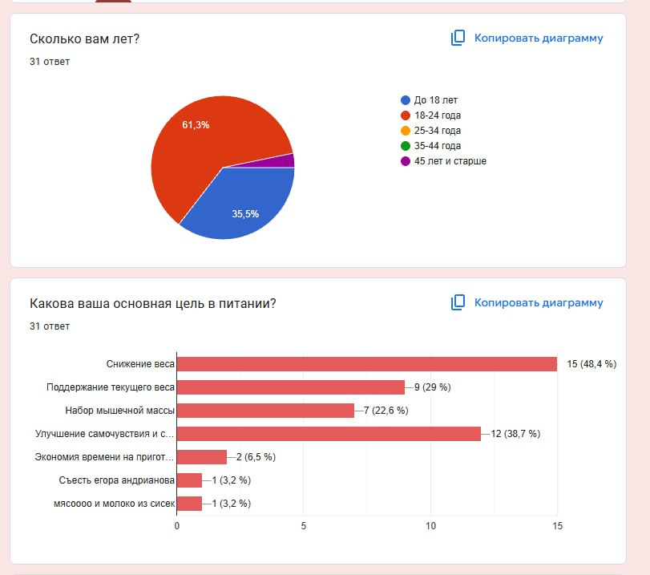
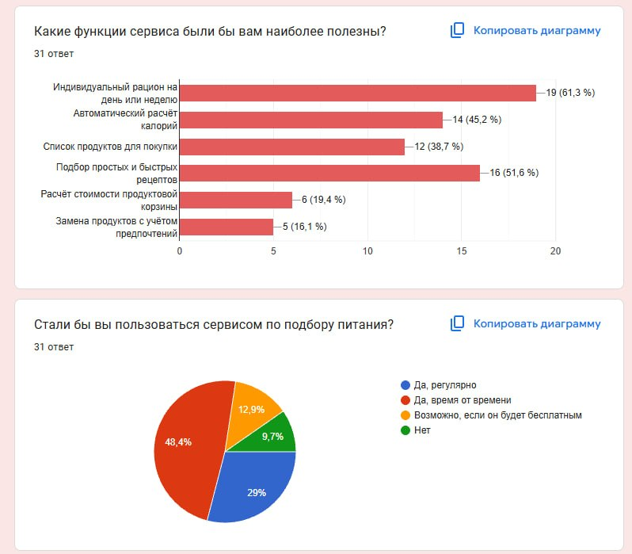

# Самостоятельная работа № 3. Определение целевой аудитории

Тема: Сервис по подбору питания.

---

## 1. Цель работы и исходные данные

Цель работы — определить целевую аудиторию сервиса по подбору питания, описать потребности пользователей и установить, как они повлияют на будущий продукт.

Для анализа использованы результаты анкетирования в Google Forms. В опросе участвовал 31 человек.

Возраст участников:
* До 18 лет — 11 человек (35,5%);
* 18–24 года — 19 человек (61,3%);
* 45 лет и старше — 1 человек (3,2%).

Таким образом, в исследованной выборке абсолютно преобладают пользователи младше 25 лет.

<!-- СКРИН 1 -->

---

## 2. Сегменты целевой аудитории

Разделение пользователей было произведено по их ключевым целям и потребностям в организации питания.

### Сегмент 1. Пользователи, стремящиеся снизить или поддерживать вес

| Характеристика | Описание |
| --- | --- |
| Возраст | Точный возраст сегмента отдельно не установлен. В общей выборке большинство участников младше 25 лет. |
| Владение техникой | Не исследовалось. Предполагаются базовые навыки использования сайтов и приложений. |
| Контекст использования | Планирование меню на день или неделю, выбор блюд с учётом цели по весу. |
| Потребности | Индивидуальный рацион, автоматический расчёт калорийности, учёт предпочтений и ограничений. |
| Проблемы | Предположительно, трудности с самостоятельным расчётом калорийности и составлением подходящего меню. |

* Обоснование: Снижение веса выбрали 15 респондентов (48,4%), поддержание текущего веса — 9 (29%). Важность расчета калорийности отметили в сумме 48,4% (очень важен — 22,6%, скорее важен — 25,8%).

### Сегмент 2. Пользователи, стремящиеся набрать мышечную массу

| Характеристика | Описание |
| --- | --- |
| Возраст | Точный возраст сегмента отдельно не установлен. В общей выборке большинство участников младше 25 лет. |
| Владение техникой | Не исследовалось. Предполагаются базовые навыки использования сайтов и приложений. |
| Контекст использования | Подбор рациона для набора мышечную массы, контроль БЖУ и планирование покупок. |
| Потребности | Питание с учётом выбранной цели, расчёт калорийности, информация о составе блюд и список продуктов. |
| Проблемы | Предположительно, трудности с подбором сбалансированного рациона под профицит калорий и регулярным планированием питания. |

* Обоснование: Набор мышечной массы указали 7 респондентов (22,6%).

### Сегмент 3. Пользователи, нуждающиеся в помощи организации повседневного питания

| Характеристика | Описание |
| --- | --- |
| Возраст | Точный возраст сегмента отдельно не установлен. В общей выборке преобладают пользователи до 18 лет и 18–24 лет. |
| Владение техникой | Не исследовалось. Предполагаются базовые навыки использования сайтов и приложений. |
| Контекст использования | Повседневный выбор блюд, планирование покупок и приготовление еды, в том числе при ограниченном времени и бюджете. |
| Потребности | Простые и быстрые рецепты, готовое меню, список покупок и учёт бюджета. |
| Проблемы | Нерегулярное питание и пропуски приёмов пищи. Предположительно, трудности с выбором блюд и планированием покупок. |

* Обоснование: 7 участников (22,6%) питаются нерегулярно и часто пропускают приёмы пищи. Подбор простых и быстрых рецептов интересен 16 участникам (51,6%), список продуктов для покупки — 12 (38,7%). Основная масса (38,7%) ориентируется на средний бюджет 500–800 руб/день.

<!-- СКРИН2 -->

---

## 3. Портреты пользователей (Персонажи)

*Ниже приведены детализированные портреты типичных представителей каждого сегмента, разработанные для очеловечивания потребностей аудитории.*

### Портрет 1. Анна, 20 лет — хочет снизить вес
Анна хочет организовать питание так, чтобы сбросить лишний вес, при этом питаясь вкусно. Она обращается к сервису, чтобы планировать питание на ближайшую неделю с расчётом калорий и возможностью указать нелюбимые блюда или продукты.

Портрет Анны представляет пользователей, которые хотят контролировать вес. В опросе снижение веса выбрали 15 человек (48,4%), а поддержание текущего веса — 9 человек (29%). Кроме того, 16 респондентов (51,6%) учитывают калорийность и состав продуктов при их выборе. Поэтому в портрете основной акцент сделан на подборе меню и расчёте калорийности. Имя и точный возраст Анны выбраны условно.

<!-- СКРИН 3 -->

### Портрет 2. Максим, 22 года — хочет набрать мышечную массу
Максим тренируется и хочет подбирать питание с учётом цели набора мышечной массы. Он использует сервис при планировании питания на неделю и перед покупкой продуктов. Ему нужен рацион под выбранную цель с понятной калорийностью и списком необходимых продуктов.

Портрет Максима основан на ответах 7 участников (22,6%), указавших набор мышечной массы как цель питания. Этот сегмент выделен отдельно, поскольку его цель отличается от снижения или поддержания веса и должна учитываться при подборе рациона. В портрете отражена потребность в планировании питания под конкретную задачу. Имя, точный возраст и наличие тренировок — условные детали: вопросы о тренировках в представленных результатах опроса отсутствуют.

### Портрет 3. Дарья, 19 лет — хочет наладить повседневное питание
Дарья совмещает учёбу с другими делами и иногда пропускает приёмы пищи. Она хочет питаться регулярнее и тратить меньше сил на выбор блюд. Дарья открывает сервис, когда нужно быстро выбрать блюдо или подготовить список покупок. Ей важны простые рецепты, доступные продукты и возможность указать бюджет.

Портрет Дарьи отражает потребность в более удобной организации питания. Семь участников (22,6%) сообщили, что питаются нерегулярно и часто пропускают приёмы пищи. Подбор простых и быстрых рецептов выбрали 16 человек (51,6%), а список продуктов для покупки — 12 человек (38,7%). Эти результаты дают основание выделить сегмент, для которого важна помощь с ежедневным меню. Имя, точный возраст и занятость Дарьи учёбой — условные детали портрета.

Также портреты пользователей представлены в 
---

## 4. Вывод и влияние на будущий продукт

Особенности целевой аудитории определяют архитектуру и основные функции будущего сервиса:

1. Функциональные приоритеты (MVP): 61,3% пользователей назвали самой полезной функцией *«Индивидуальный рацион на день/неделю»*, а 51,6% — *«Подбор простых и быстрых рецептов»*. Экран с недельным планом питания и каталогом быстрых рецептов должен быть ключевым в интерфейсе.
2. Фокус на вкусовые качества: Поскольку фактор «Вкус» (74,2%) лидирует с огромным отрывом, алгоритм подбора питания не должен предлагать пресные «жесткие» диеты. Необходим гибкий фильтр для исключения нелюбимых продуктов, чтобы адаптировать меню под вкусы пользователя.
3. Автоматизация покупок: Потребность в списке продуктов выразили 38,7% опрошенных. Сервис должен автоматически генерировать чек-лист ингредиентов на основе выбранного плана питания для удобного похода в магазин.
4. Учет ограничений: Различия в целях пользователей требуют возможности гибкого переключения режимов приложения: «Снижение/поддержание веса» (суммарно более 77% запросов), «Набор мышечной массы» (22,6%) или «Простые рецепты под бюджет» (бюджет до 800 руб/день является лидирующим).
5. Модель монетизации: Опрос показал, что только 29% готовы пользоваться сервисом регулярно на постоянной основе, тогда как 48,4% планируют заходить «время от времени», а 12,9% выберут сервис только при условии его бесплатности. Таким образом, жесткая платная подписка разрушит базу пользователей. Оптимальным решением будет Freemium-модель: базовый доступ к простым рецептам и спискам покупок бесплатный, а глубокий медицинский/спортивный расчет КБЖУ и кастомизация — по платной подписке.

<!-- СКРИН 4 -->

