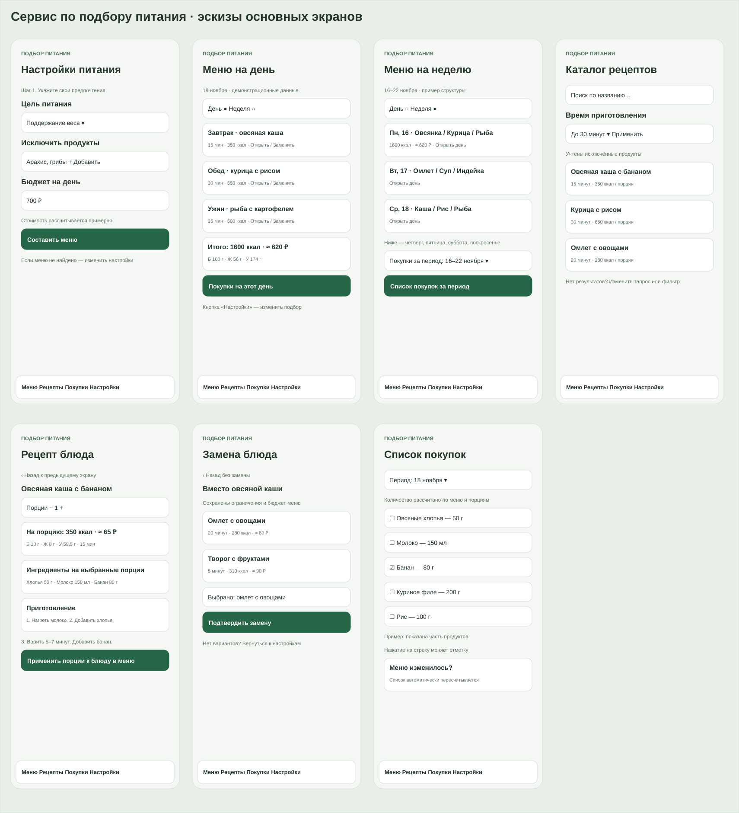
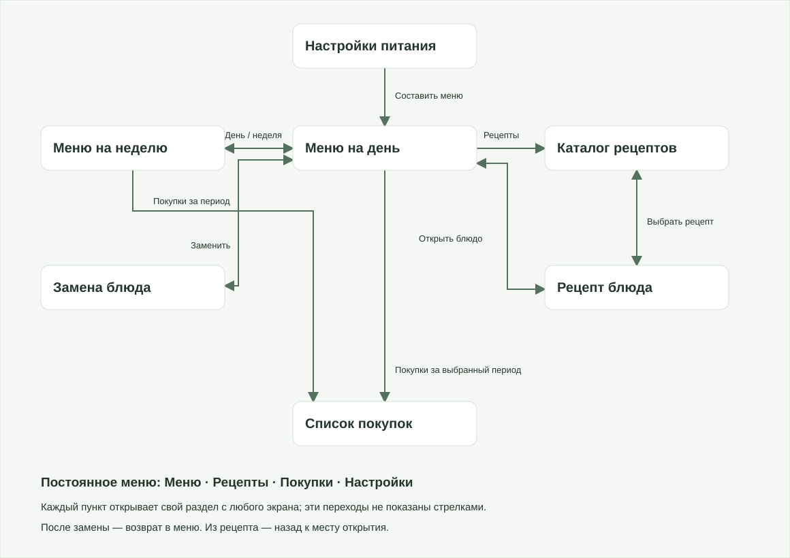

# Самостоятельная работа № 5. Проектирование пользовательского интерфейса

Тема: Сервис по подбору питания.

---

## 1. Цель работы и исходные данные

Цель работы — спроектировать основные экраны сервиса по подбору питания, определить их элементы и продумать переходы между ними.

За основу взят перечень функциональных требований, подготовленный в работе № 4. Он включает выбор цели питания, исключение продуктов, составление меню на день и неделю, просмотр калорийности и БЖУ, подбор рецептов, учёт бюджета, замену блюд, изменение порций и формирование списка покупок. Пока этот перечень не согласован командой, макеты также могут уточняться.

При проектировании учитывались результаты работы № 3. В опросе участвовал 31 человек. Большинство респондентов младше 25 лет. Индивидуальный рацион интересен 61,3% участников, простые и быстрые рецепты — 51,6%, список покупок — 38,7%.

В качестве варианта интерфейса выбран сайт с адаптацией для телефона. На этом этапе подготовлены статические эскизы: они показывают структуру экранов и расположение элементов, но не выполняют подбор питания. Мобильный формат выбран как проектное решение; устройство доступа в представленном опросе не исследовалось.

## 2. Перечень экранов

| № | Экран | Назначение | Связанные требования |
| --- | --- | --- | --- |
| 1 | Настройки питания | Выбор цели, исключаемых продуктов и дневного бюджета перед составлением меню | ФТ-01, ФТ-02, ФТ-08 |
| 2 | Меню на день | Просмотр блюд по приёмам пищи, калорийности, БЖУ и стоимости за день | ФТ-03, ФТ-05, ФТ-09, ФТ-14 |
| 3 | Меню на неделю | Просмотр плана на семь дней и выбор периода для покупок | ФТ-04, ФТ-12 |
| 4 | Каталог рецептов | Поиск блюд по названию и фильтрация по времени приготовления | ФТ-06, ФТ-07 |
| 5 | Рецепт блюда | Просмотр ингредиентов, инструкции, пищевой ценности и изменение порций | ФТ-05, ФТ-06, ФТ-11 |
| 6 | Замена блюда | Выбор другого блюда для конкретного приёма пищи | ФТ-10, ФТ-14 |
| 7 | Список покупок | Просмотр суммарного количества продуктов за выбранный период и отметка купленного | ФТ-12, ФТ-13, ФТ-14 |

Отдельный экран регистрации в первой версии не предусмотрен, поскольку регистрация была отложена при подготовке требований. Пользователь может начать с настройки питания.

## 3. Основные элементы экранов

### 3.1. Настройки питания

На экране находятся список целей питания, поле исключаемых продуктов, поле бюджета в рублях на день и кнопка «Составить меню». Цель выбирается из трёх вариантов: снижение веса, поддержание веса и набор мышечной массы. Исключённые продукты можно добавлять и удалять.

Рядом с бюджетом размещено пояснение о приблизительном расчёте стоимости. Если подходящее меню составить не удалось, сервис показывает сообщение и предлагает изменить ограничения. Некорректный бюджет, например отрицательное число, отмечается рядом с полем.

### 3.2. Меню на день

В верхней части экрана показана выбранная дата и переключатель «День / Неделя». Ниже расположены карточки приёмов пищи. В каждой карточке указаны название блюда, время приготовления и калорийность. Нажатие на название открывает рецепт, а действие «Заменить» открывает подбор альтернативы.

Под карточками размещены суммарные калории, БЖУ и приблизительная стоимость дня. Кнопка «Покупки на этот день» открывает список ингредиентов. Переход в настройки позволяет изменить исходные параметры и заново составить меню.

### 3.3. Меню на неделю

Экран содержит семь карточек дней с кратким составом меню. Нажатие на карточку открывает подробное меню выбранного дня. Дни располагаются вертикально, чтобы их можно было просматривать на небольшом экране без горизонтальной прокрутки.

Перед переходом к покупкам пользователь выбирает диапазон дней. По умолчанию выбрана вся неделя. На эскизе показана верхняя часть списка; остальные дни доступны при прокрутке.

### 3.4. Каталог рецептов

Вверху находятся строка поиска по названию, фильтр максимального времени приготовления и кнопка применения фильтра. Ниже отображаются карточки рецептов с названием, временем приготовления и калорийностью одной порции.

При поиске учитываются исключённые продукты из настроек. Если ничего не найдено, вместо пустого списка появляется пояснение с предложением изменить запрос или фильтр.

### 3.5. Рецепт блюда

На экране показаны название блюда, время приготовления, калорийность и БЖУ на порцию, приблизительная стоимость, ингредиенты и пошаговая инструкция. Количество порций меняется кнопками «−» и «+», минимальное значение — одна порция.

При изменении порций пересчитываются общее количество ингредиентов и стоимость. Если рецепт открыт из меню, кнопка «Применить порции к блюду в меню» сохраняет изменение и обновляет итоги меню и покупки. Если рецепт открыт из каталога, пользователь просматривает расчёт порций без изменения своего меню. Пищевая ценность одной порции остаётся прежней; итог для выбранного количества порций рассчитывается отдельно.

Кнопка «Назад» возвращает на тот экран, откуда был открыт рецепт.

### 3.6. Замена блюда

Экран показывает заменяемое блюдо и доступные альтернативы. У каждой альтернативы указаны время приготовления, калорийность и стоимость. Пользователь выбирает один вариант и нажимает «Подтвердить замену».

После подтверждения сервис возвращает пользователя в меню и пересчитывает калорийность, БЖУ, стоимость и список покупок. Ограничения по продуктам и бюджету сохраняются. Если подходящих вариантов нет, появляется сообщение с переходом к настройкам. Выход назад без подтверждения не изменяет блюдо.

### 3.7. Список покупок

В верхней части расположен выбор периода. Далее показаны продукты с количеством и единицами измерения. Одинаковые ингредиенты объединяются, их количество суммируется после приведения к одинаковым единицам.

Нажатие на строку ставит отметку о покупке, повторное нажатие снимает её. Отметка видна по флажку и не зависит только от цвета. Если меню изменилось, список пересчитывается; отметки сохраняются для неизменившихся позиций. Для продуктов, количество которых изменилось, отметка сбрасывается, чтобы пользователь проверил нужное количество.

## 4. Эскизы основных экранов

На макетах показаны расположение элементов, подписи кнопок и основные действия. Названия блюд, цены и пищевая ценность приведены как демонстрационные данные, а не как персональная рекомендация по питанию. Меню на день является фрагментом для иллюстрации интерфейса.

## 5. Навигация между экранами

В нижней части экранов размещается постоянное меню из четырёх разделов: «Меню», «Рецепты», «Покупки» и «Настройки». Пункт «Меню» открывает последний просмотренный день или неделю. При первом использовании открываются настройки питания. Если меню ещё не составлено, в его разделе появляется предложение перейти к настройкам.

| Откуда | Действие | Куда |
| --- | --- | --- |
| Настройки питания | Нажать «Составить меню» при корректных данных | Меню на день |
| Меню на день | Выбрать «Неделя» | Меню на неделю |
| Меню на неделю | Выбрать день | Меню выбранного дня |
| Меню на день | Нажать название блюда | Рецепт блюда |
| Меню на день | Нажать «Заменить» | Замена блюда |
| Замена блюда | Подтвердить выбор | Меню с новым блюдом |
| Каталог рецептов | Выбрать рецепт | Рецепт блюда |
| Рецепт блюда | Нажать «Назад» | Экран, с которого открыт рецепт |
| Меню на день или неделю | Нажать кнопку списка покупок | Покупки за выбранный период |
| Любой экран | Выбрать пункт нижнего меню | Соответствующий раздел |

Основной сценарий: пользователь задаёт цель, исключения и бюджет, получает меню, при необходимости заменяет блюдо, затем открывает список покупок. Рецепт можно посмотреть как из готового меню, так и через каталог.

## 6. Обоснование решений с учётом аудитории

Индивидуальный рацион выбрали 61,3% участников опроса, поэтому меню сделано главным разделом сервиса. В нём сразу видны блюда и итоговые значения за день. Переключение между днём и неделей позволяет как быстро выбрать еду на сегодня, так и спланировать питание заранее.

Простые и быстрые рецепты интересны 51,6% респондентов. Поэтому время приготовления показано прямо в карточке, а в каталоге предусмотрен соответствующий фильтр. Пользователю не нужно открывать каждый рецепт, чтобы узнать, сколько времени потребуется.

Вкус учитывают 74,2% опрошенных. Возможность исключить нелюбимые продукты и заменить конкретное блюдо помогает подобрать более подходящее меню без его полного пересоздания.

Список покупок выбрали 38,7% участников. Он вынесен в отдельный раздел и доступен из меню. Автоматическое объединение ингредиентов уменьшает количество ручных расчётов.

Диапазон бюджета 500–800 рублей в день выбрали 38,7% респондентов. Поэтому бюджет можно указать до формирования рациона, а стоимость меню видна рядом с итогами. Приблизительный характер цен обозначен текстом.

Для трёх сегментов аудитории предусмотрен выбор цели питания. При этом интерфейс использует одну общую структуру: меняются параметры подбора, а расположение основных действий сохраняется.

В оформлении используются светлый фон, тёмный текст и зелёный акцент для основных кнопок. Элементы подписаны словами, поля имеют названия, а основные действия размещены на заметном месте. Крупные области нажатия и вертикальная структура выбраны для удобства на телефоне. Эти решения являются проектными предположениями: удобство ещё нужно проверить на пользователях.

## 7. Вывод

В работе определены семь экранов сервиса по подбору питания, описаны их элементы и подготовлены эскизы. Также составлена карта переходов и описан основной сценарий от выбора параметров до списка покупок.

Предложенный интерфейс связан с требованиями из предыдущей работы и потребностями аудитории: планированием рациона, поиском быстрых рецептов, учётом вкусов и бюджета. Следующий шаг — показать макеты пользователям и проверить, смогут ли они без подсказок составить меню, заменить блюдо и найти список покупок. По результатам проверки можно уточнить подписи и расположение элементов.

